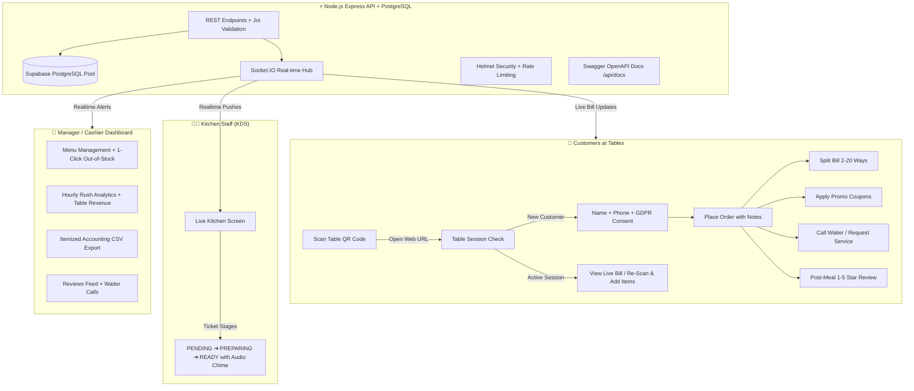

# 🍽️ Restaurant QR Backend

A production-grade, lightweight, and super-fast backend API for a **contactless table QR ordering system**, built with **Node.js, Express, PostgreSQL (Supabase), and Socket.IO real-time websockets**.

[](https://github.com/TARUNKARTHICKG14/restaurant-qr-backend/actions/workflows/ci.yml)
[](https://opensource.org/licenses/MIT)
[](https://nodejs.org/)
[-blue.svg)](https://supabase.com/)

---

## 🌟 Key Architecture & Capabilities



---

## 🚀 Quick Start Guide

### 1. Prerequisites
- **Node.js** v20+ installed
- A **PostgreSQL database** (e.g. Supabase, Neon, or local PostgreSQL)

### 2. Clone & Install
```bash
git clone https://github.com/TARUNKARTHICKG14/restaurant-qr-backend.git
cd restaurant-qr-backend
npm install
```

### 3. Setup Environment Variables
Create a `.env` file in the root directory:
```ini
PORT=3000
NODE_ENV=development

# Database Connection (Supabase / PostgreSQL)
DB_HOST=db.your-supabase-project.supabase.co
DB_PORT=5432
DB_NAME=postgres
DB_USER=postgres
DB_PASSWORD=your_password

# Admin Credentials
ADMIN_EMAIL=admin@example.com
ADMIN_PASS=supersecret
JWT_SECRET=super_secret_jwt_key_change_in_production

# Client Domain (For QR deep links)
CLIENT_URL=http://localhost:3000
```

### 4. Database Setup & Seeding
```bash
# 1. Apply schema and create tables:
npm run db:migrate

# 2. Seed realistic demo restaurant ("Royal Spice Bistro", 5 tables, 13 dishes, 2 coupons):
npm run seed
```

### 5. Run the Server
```bash
# Development with live-reload:
npm run dev

# Production:
npm start
```
The server will start on **`http://localhost:3000`**.  
Interactive Swagger documentation is available at **`http://localhost:3000/api/docs`**.

---

## 🧪 Automated Testing

Run the full end-to-end integration and regression test suite powered by **Jest & Supertest**:
```bash
npm test
```
All 15 comprehensive tests execute in isolated transactions against the database.

---

## 📡 REST API Directory

| Section | Method | Endpoint | Description |
|---|---|---|---|
| **System** | `GET` | `/health` | Health check & security audit |
| | `GET` | `/api/docs` | Interactive Swagger OpenAPI Playground |
| **Menu** | `GET` | `/api/menu/:restaurantId` | Categorized dishes (`?groupByCategory=true&availableOnly=true`) |
| | `GET` | `/api/menu/:restaurantId/categories` | Unique category list (Starters, Breads, Mains, etc.) |
| **QR Engine** | `GET` | `/api/qr/:tableId` | High-res PNG/SVG QR code (`?format=svg&size=600&download=true`) |
| | `GET` | `/api/qr/restaurant/:restaurantId/bulk` | Batch generate QR stickers for all tables at once |
| **Table Orders** | `GET` | `/api/order/table/:tableId/session` | Table session memory (re-scan without re-login) |
| | `POST` | `/api/order` | Place order (GDPR consent enforced, subtotal & tax computed) |
| | `POST` | `/api/order/:id/items` | Add items to running bill on re-scan |
| | `POST` | `/api/order/:id/apply-coupon` | Apply promo code (`code: 'WELCOME10'`) |
| | `DELETE`| `/api/order/:id/remove-coupon` | Remove promo code and recalculate bill |
| | `GET` | `/api/order/:id/split?ways=3` | Equal bill splitting with zero-loss penny rounding |
| | `PUT` | `/api/order/:id/dismiss` | Settle bill (`paymentMethod: 'UPI'/'CASH'/'CARD'`) & free table |
| **Service** | `POST` | `/api/order/table/:tableId/call-waiter`| Tap to call waiter (`WATER`, `BILL`, `CUTLERY`, etc.) |
| | `POST` | `/api/order/:id/feedback` | Post-meal 1-5 star review & comments |
| **Kitchen (KDS)**| `GET` | `/api/kitchen/tickets` | Live ticket feed (`pending`, `preparing`, `ready`) with wait timer |
| | `PUT` | `/api/kitchen/tickets/:id/advance` | 1-click stage advancement (`PENDING ➔ PREPARING ➔ READY ➔ SERVED`) |
| **Admin** | `POST` | `/api/admin/login` | Authenticate & obtain JWT Bearer token |
| | `PUT` | `/api/admin/restaurant/:id/tax` | Configure GST/VAT percentage & currency |
| | `PUT` | `/api/admin/menu/:id/toggle-availability`| 1-click out-of-stock toggle (real-time broadcast) |
| | `GET` | `/api/admin/analytics/overview` | Peak hours rush, payment breakdown, table sales leaderboard |
| | `GET` | `/api/admin/customers` | Customer directory with lifetime spend & visit history |
| | `GET` | `/api/admin/reports/sales/csv` | Download itemized accounting sales spreadsheet |
| | `POST` | `/api/admin/coupons` | Create promotional percentage or flat discount coupons |

---

## ⚡ WebSocket Real-Time Events (`Socket.IO`)

Connect to the Socket.IO server at `/` and listen for live events:

| Event Name | Room | Payload | Purpose |
|---|---|---|---|
| `order:new` | Global / Kitchen | `{ orderId, tableId, total }` | New order placed by diner |
| `order:items_added` | Kitchen / Table | `{ orderId, tableId, addedItems, total }` | Customer added more items on re-scan |
| `order:status` | Kitchen / Table | `{ orderId, status, total }` | Chef updated order cooking status |
| `kitchen:ticket_advanced` | Kitchen | `{ orderId, newStatus, playChime: true }` | Food plated & ready for delivery |
| `waiter:call` | Waiter Staff | `{ tableNumber, requestType, playChime: true }`| Customer tapped call waiter button |
| `menu:availability_changed`| All Tables | `{ id, name, available }` | Dish dynamically marked out-of-stock |
| `feedback:new` | Admin | `{ orderId, rating, comments, isCritical }` | Customer left a review |

---

## 🐳 Docker Deployment

### Run with Docker Compose
```bash
docker compose up -d --build
```
The container runs as an unprivileged `node` user with built-in health-checks on port `3000`.

---

## ☁️ 1-Click Cloud Deployment

### Deploy to Render
The repository includes a ready-to-use **`render.yaml`** blueprint.
1. Connect your GitHub repository to [Render](https://render.com).
2. Create a new **Blueprint**. Render will automatically detect `render.yaml` and provision the service.

### Deploy to Railway
The repository includes **`railway.json`** for automated Docker builds.
1. Click **New Project** on [Railway](https://railway.app) ➔ **Deploy from GitHub repo**.
2. Add your environment variables in the Railway dashboard.

---

## 📄 License
This project is open-source under the [MIT License](LICENSE).
